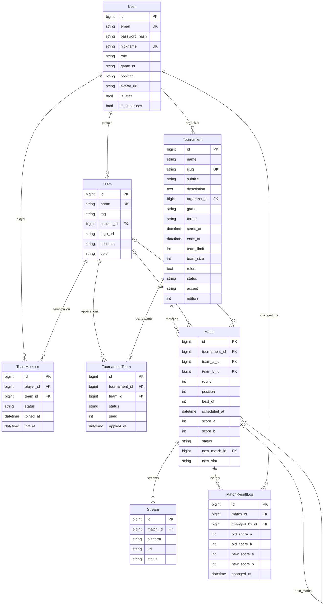

# Структура базы IGNITE

Этап 30.10.2026. База PostgreSQL, модели Django в `tournaments/models.py`.
Основа — восемь сущностей из ТЗ и ранее подготовленной диаграммы классов.
UML-диаграмма описывает полную систему; на этом этапе реализованы данные и админка, а не все будущие методы.

`PK` — идентификатор, `FK` — связь, `UK` — уникальное поле. `0..1` — необязательная связь, `0..*` — любое количество записей.
В модели Django хеш пароля хранится в стандартном поле `password`, аватар в `avatar`, логотип в `logo`. Названия на схеме поясняют тип содержимого.

## Что проверяется

- Email уникален без учёта регистра. Вход в админку выполняется по email.
- Для игрока и команды создаётся одна запись TeamMember, в которой меняется состояние.
- Для команды и турнира создаётся одна заявка. Одобренные номера посева не повторяются.
- Конец турнира не раньше начала, лимит — не менее двух команд.
- Матч не может содержать одного соперника с обеих сторон. Указанные команды должны быть приняты в турнир.
- Номер матча уникален внутри раунда турнира. Счёт задаётся для обеих сторон и проверяется с учётом BO1/BO3/BO5.
- Следующий матч принадлежит тому же турниру и более позднему раунду. У него два места: `a` и `b`, по одному предыдущему матчу на место.
- В круговом турнире ссылка на следующий матч не используется.
- При изменении счёта через админку автоматически записываются автор и прежние/новые значения. Запись счёта и истории выполняется в одной транзакции.
- Журнал доступен для просмотра, но не для ручного редактирования в админке.

Простые ограничения продублированы в PostgreSQL. Проверки состава, лимита и формата выполняются формами и `Model.clean()`; код, который в будущем записывает данные напрямую через ORM, также должен вызывать валидацию. Обработка одновременных заявок и продвижение победителя относятся к следующим этапам.

## Хранение и удаление

Данные сохраняются в PostgreSQL и остаются после перезапуска Django. Капитаны, организаторы, участники и авторы истории защищены `PROTECT`, пока используются в связанных записях. При удалении турнира его матчи и заявки удаляются каскадно; стандартная админка заранее показывает список связанных объектов. Не удаляйте учебный турнир ради проверки изменения полей.

Дата и время хранятся с часовым поясом; на сайте и в админке показываются по Москве.
Логотипы и аватары пока задаются ссылками. Загрузка файлов, игровые показатели и исторические снимки составов добавляются на следующих этапах.
